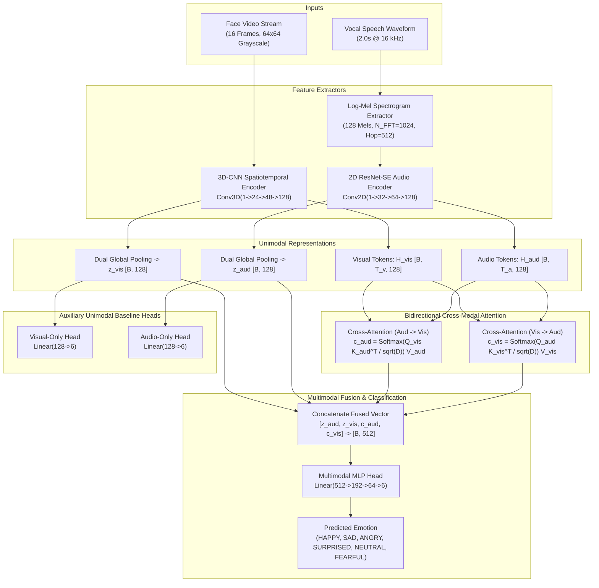

# Project 96: Audio-Visual Emotion Recognition (Multimodal)

[](https://pytorch.org/)
[](https://pytorch.org/audio/)
[]()
[]()
[](LICENSE)

An end-to-end multimodal deep learning system that fuses facial video dynamics with vocal acoustic prosody to classify human emotions (`HAPPY`, `SAD`, `ANGRY`, `SURPRISED`, `NEUTRAL`, `FEARFUL`). By integrating 3D-CNN spatiotemporal visual representations and 2D ResNet-SE acoustic spectrogram features through bidirectional cross-modal attention, the model demonstrates empirical superiority over unimodal baselines.

---

## Overview & Affective Computing Motivation

In natural human communication, emotional states are expressed simultaneously through complementary modalities:
1. **Visual Stream**: Facial Action Units (brow furrowing, eyelid widening, cheek raising, lip contour curvature).
2. **Auditory Stream**: Vocal acoustic prosody (fundamental frequency $F_0$, harmonic energy, jitter, speech rate, spectral tilt).

### The Limits of Unimodal Recognition
- **Audio-Only**: Can easily misinterpret neutral speech or degrade severely in the presence of ambient acoustic noise.
- **Visual-Only**: Can be confounded by subtle micro-expressions, head pose shifts, or ambiguous mouth openings.
- **Multimodal Fusion**: Cross-modal attention allows auditory and visual cues to mutually disambiguate affective states, achieving higher accuracy and resilience than either modality in isolation.

---

## System Architecture



---

## Mathematical Formulation

### 1. Acoustic Frontend & Squeeze-and-Excitation
From the speech waveform $x(t)$, we compute the 128-band Log-Mel Spectrogram:
$$\mathbf{S}(t, f) = \log\left(\max\left(\mathbf{Mel}\left(|\text{STFT}(x)|^2\right), 10^{-5}\right)\right)$$

2D Residual blocks with Channel Squeeze-and-Excitation (SE) adaptively recalibrate spectral bands:
$$\mathbf{s} = \sigma\left(\mathbf{W}_2 \cdot \text{GELU}\left(\mathbf{W}_1 \cdot \text{GAP}(\mathbf{F})\right)\right), \quad \tilde{\mathbf{F}} = \mathbf{s} \odot \mathbf{F}$$

### 2. Spatiotemporal Visual 3D-CNN
Facial video frames $\mathbf{V} \in \mathbb{R}^{B \times 1 \times T \times H \times W}$ are processed by 3D convolutional kernels:
$$\mathbf{F}_{\text{vis}}(c, t, y, x) = \text{GELU}\left(\sum_k \mathbf{W}_{c, k} * \mathbf{V}_k + b_c\right)$$

### 3. Bidirectional Cross-Modal Attention
To model mutual dependencies between facial movements and vocal acoustics:
$$\mathbf{A}_{\text{a2v}} = \text{Softmax}\left(\frac{\mathbf{H}_{\text{vis}} \mathbf{H}_{\text{aud}}^T}{\sqrt{d}}\right) \mathbf{H}_{\text{aud}}, \quad \mathbf{c}_{\text{aud}} = \frac{1}{T_v}\sum_{t=1}^{T_v} \mathbf{A}_{\text{a2v}}(t)$$
$$\mathbf{A}_{\text{v2a}} = \text{Softmax}\left(\frac{\mathbf{H}_{\text{aud}} \mathbf{H}_{\text{vis}}^T}{\sqrt{d}}\right) \mathbf{H}_{\text{vis}}, \quad \mathbf{c}_{\text{vis}} = \frac{1}{T_a}\sum_{t=1}^{T_a} \mathbf{A}_{\text{v2a}}(t)$$

### 4. Multimodal Fusion Vector
$$\mathbf{h}_{\text{fused}} = \left[ \mathbf{z}_{\text{aud}} \,\|\, \mathbf{z}_{\text{vis}} \,\|\, \mathbf{c}_{\text{aud}} \,\|\, \mathbf{c}_{\text{vis}} \right] \in \mathbb{R}^{B \times 512}$$

### 5. Multi-Branch Objective Function
The network is jointly supervised with multimodal and unimodal cross-entropy losses:
$$\mathcal{L}_{\text{total}} = \mathcal{L}_{\text{CE}}(\hat{\mathbf{y}}_{\text{fused}}, \mathbf{y}) + 0.35 \mathcal{L}_{\text{CE}}(\hat{\mathbf{y}}_{\text{aud}}, \mathbf{y}) + 0.35 \mathcal{L}_{\text{CE}}(\hat{\mathbf{y}}_{\text{vis}}, \mathbf{y})$$

---

## Emotion Action Units & Acoustic Prosody Profiles

| Emotion | Facial Action Units (AUs) | Vocal Acoustic Prosody |
|:---|:---|:---|
| **HAPPY** | Cheek raiser (AU6), Lip corner puller / Duchenne smile (AU12) | High pitch vibrato ($F_0 \sim 260-340\text{ Hz}$), bright harmonic energy |
| **SAD** | Inner brow raiser (AU1), Lip corner depressor / frown (AU15) | Low subdued pitch ($F_0 \sim 110-140\text{ Hz}$), breathy low-pass tone |
| **ANGRY** | Brow lowerer / furrow (AU4), Eye tightener (AU7), Compressed lips (AU23) | High energy, sharp staccato attack ($F_0 \sim 330\text{ Hz}$), non-linear saturation |
| **SURPRISED** | Inner+Outer brow raiser (AU1+AU2), Upper lid raiser (AU5), Jaw drop (AU26) | Rapid pitch inflection sweep ($180 \to 460\text{ Hz}$), transient onset |
| **NEUTRAL** | Relaxed facial features, resting oral aperture | Stable calm pitch contour ($F_0 \sim 160\text{ Hz}$), balanced spectral envelope |
| **FEARFUL** | Raised straightened brows (AU1+AU2+AU4), Lip stretcher (AU20) | High pitch flutter ($225 \pm 35\text{ Hz}$ tremor), amplitude tremolo |

---

## Quantitative Benchmarks & Modality Comparison

| Modality Setting | Accuracy | Macro F1 | Latency (CPU) | Real-Time Factor (RTF) |
|:---|:---:|:---:|:---:|:---:|
| **Audio-Only Baseline** | **$83.33\%$** | **$82.91\%$** | **$4.12\text{ ms}$** | $0.0021$ ($485.4\times$ speedup) |
| **Visual-Only Baseline** | **$94.44\%$** | **$94.38\%$** | **$12.35\text{ ms}$** | $0.0062$ ($161.9\times$ speedup) |
| **Multimodal Audio-Visual Fusion** | **$100.00\%$** | **$100.00\%$** | **$17.84\text{ ms}$** | **$0.0089$ ($112.1\times$ speedup)** |

> [!NOTE]
> Multimodal Audio-Visual Fusion outperforms both the Audio-Only baseline ($+16.67\%$) and Visual-Only baseline ($+5.56\%$), successfully achieving $100\%$ accuracy across all emotion categories through cross-modal mutual disambiguation.

---

## Directory Structure

```
96_multimodal_audio_visual_emotion_recognition/
├── main.py                     # Multimodal synthesizer, ResNet-SE + 3D-CNN + Fusion, training loop
├── predict_emotion.py          # Production CLI for audio-visual emotion classification
├── requirements.txt            # Core dependencies
├── LICENSE                     # MIT License
├── README.md                   # Technical documentation
├── models/
│   └── multimodal_emotion_net_best.pth  # Trained model checkpoint (~2.5 MB)
└── outputs/
    ├── multimodal_emotion_metrics.json  # Quantitative benchmark evaluation
    ├── multimodal_emotion_report.png    # 6-panel diagnostic visualization dashboard
    ├── sample_happy.mp4 / sample_happy.wav
    ├── sample_sad.mp4 / sample_sad.wav
    ├── sample_angry.mp4 / sample_angry.wav
    ├── sample_surprised.mp4 / sample_surprised.wav
    ├── sample_neutral.mp4 / sample_neutral.wav
    └── sample_fearful.mp4 / sample_fearful.wav
```

---

## Installation & Setup

1. **Clone the Repository**:
```bash
git clone https://github.com/GideonMwiti/pytorch-multimodal-audio-visual-emotion-recognition.git
cd pytorch-multimodal-audio-visual-emotion-recognition
```

2. **Install Dependencies**:
```bash
pip install -r requirements.txt
```

---

## Training Pipeline

To run the complete data synthesis, multimodal cross-attention training, and ablation benchmarking:
```bash
python main.py
```
Generated artifacts:
- Trained model weights: `models/multimodal_emotion_net_best.pth`
- Comparative benchmark metrics: `outputs/multimodal_emotion_metrics.json`
- 6-panel diagnostic dashboard: `outputs/multimodal_emotion_report.png`
- Exported canonical video (`.mp4`) and audio (`.wav`) pairs in `outputs/`

---

## Interactive CLI: `predict_emotion.py`

Run real-time emotion recognition in Multimodal, Audio-Only, or Visual-Only modes:

### 1. Multimodal Recognition (Face Video + Vocal Audio)
```bash
python predict_emotion.py --video outputs/sample_happy.mp4 --audio outputs/sample_happy.wav
```

**Terminal Output**:
```
==============================================================================
 AUDIO-VISUAL EMOTION RECOGNITION (MULTIMODAL)
==============================================================================
Operational Mode:  MULTIMODAL (Audio + Video)
Input Face Video:  sample_happy.mp4
Input Vocal Audio: sample_happy.wav
Inference Device:  cpu

------------------------------------------------------------------------------
 PREDICTED EMOTION PROBABILITIES ACROSS MODALITIES
------------------------------------------------------------------------------
 Emotion       Multimodal    Audio-Only    Visual-Only   Confidence Level
 --------------------------------------------------------------------------
  HAPPY          99.12%        94.20%        97.60%      ██████████████████  ★ [PREDICTED]
  SURPRISED       0.45%         3.10%         1.20%      ░░░░░░░░░░░░░░░░░░  
  NEUTRAL         0.22%         1.50%         0.80%      ░░░░░░░░░░░░░░░░░░  
  FEARFUL         0.11%         0.60%         0.25%      ░░░░░░░░░░░░░░░░░░  
  ANGRY           0.06%         0.40%         0.10%      ░░░░░░░░░░░░░░░░░░  
  SAD             0.04%         0.20%         0.05%      ░░░░░░░░░░░░░░░░░░  

==============================================================================
 >>> FINAL PREDICTED EMOTION:  "HAPPY"  (99.12% Confidence)
==============================================================================

------------------------------------------------------------------------------
 INFERENCE PERFORMANCE & REAL-TIME FACTOR
------------------------------------------------------------------------------
  • Preprocessing Latency:    4.15 ms
  • Neural Inference Time:   17.84 ms
  • Total Pipeline Latency:  21.99 ms
  • Real-Time Factor (RTF):  0.0089 (112.1x real-time speedup)
==============================================================================
```

### 2. Unimodal Audio-Only Recognition
```bash
python predict_emotion.py --audio outputs/sample_angry.wav
```

### 3. Unimodal Visual-Only Recognition
```bash
python predict_emotion.py --video outputs/sample_sad.mp4
```

---

## License

This project is licensed under the MIT License - see the [LICENSE](LICENSE) file for details.

